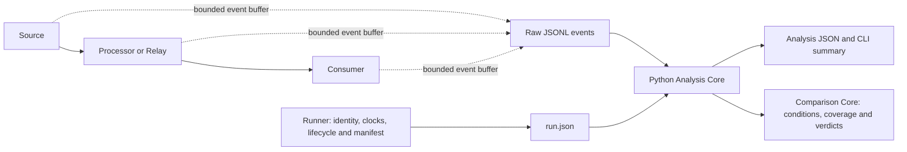

# RobotTrace

RobotTrace is a bounded ROS2 Humble runtime diagnostics project. It correlates C++ application events across a publisher → processor → consumer pipeline, checks evidence quality, and compares observed performance only when the recorded conditions and metric coverage support a verdict.

It addresses a practical debugging problem: an application can exit successfully while observations are missing, collection is incomplete, or timing evidence is unsuitable for a performance conclusion. These conditions remain separate in the analysis and CLI output.

## Architecture



The C++ collector reserves a bounded event buffer before callbacks and writes JSONL on normal shutdown. Python runtime analysis and comparison use the standard library. No host ROS installation is required; V2's one-time independent fixture preparation uses the external Python packages documented below.

The following integrations are supported:

- **Controlled pipeline:** three C++ processes, preserved message identity, configurable publish rate and processor work; normal and slow presets.
- **Instrumented upstream application:** pinned ROS2 demos Talker → topic_tools Relay → Listener, using the original serialized forwarding path. Normal and Late-Relay scenarios use 20 source messages at the upstream nominal 1 Hz. This is a rebuilt application with explicit instrumentation, not tracing of unmodified binaries.
- **V2 CPU inference:** MobileNetV2-12 FP32 through ONNX Runtime CPU 1.20.1, with two real-image tensor fixtures, independent full-output references, three ROS2 processes and identity-paired load/latency analysis. See [setup, correctness, runtime commands and limitations](docs/inference-experiment.md).

## Prerequisites and clean build

Use Linux/amd64, Python 3.10+, a POSIX shell, GNU `timeout`, and an accessible Docker Engine. The runtime has been validated on WSL2 Ubuntu. Run commands from the project root.

```sh
git clone https://github.com/guangong789/RobotTrace.git
cd RobotTrace
./environment/rebuild.sh
./scripts/build.sh
./scripts/build-upstream.sh
```

`environment/rebuild.sh` reuses the recorded local image when available; a fresh machine downloads the pinned public ROS base and builds the runtime. The Dockerfile pins the base digest and six additional package versions. Cold reconstruction depends on registry and package availability and is not guaranteed to reproduce identical bytes. `--force` requests reconstruction; `--proxy-download` provides an explicit checksum-verified crane download alternative when needed. Existing shell proxy variables are respected.

`environment/image.sh` verifies local image identity without pulling or rebuilding. A reconstruction updates `environment/image-id.txt`; rebuild the applications and validate the environment afterward. `ROBOTTRACE_IMAGE` explicitly selects an alternative local runtime and requires separate validation.

The container wrapper uses Fast DDS, domain 42, localhost-only discovery, host network/IPC, caller UID/GID, a temporary HOME and `/work` as its project mount. Upstream commands should use a host Python executable path also available in the container, such as `/usr/bin/python3`.

Builds place stripped programs and application libraries in `bin/`; upstream `build.json` records build inputs and runtime identities. Build/install/log trees live in ephemeral container storage. The upstream build also runs the C++ identity contract. The fixed upstream source subsets and instrumentation patch are included; building does not clone the full upstream projects.

## Run and analyze

A small controlled run:

```sh
python3 -B -m robottrace run --scenario normal --count 20 --rate 10
```

The command prints an `Evidence:` directory. Use that directory to reanalyze the saved raw events without ROS or Docker:

```sh
python3 -B -m robottrace analyze <run-directory>
```

`analyze` prints a summary and writes `analysis.json` in the supplied directory. Run data includes `run.json`, raw stage JSONL, collector metadata and relevant process/phase evidence. Preserve original measurements; rerunning creates a new experiment.

The upstream integration uses a separate runner:

```sh
/usr/bin/python3 -B -m robottrace.upstream normal
/usr/bin/python3 -B -m robottrace.upstream late-relay
```

Normal expects 20 complete identities and 180 events. Late-Relay publishes three messages before Relay starts, confirms matching before resuming, and expects 17 complete identities and 162 events. It distinguishes complete collection from missing downstream observations. See [upstream integration](docs/upstream-integration.md) for phase control, actual QoS, identity binding and readiness failure diagnostics.

## Evidence-aware comparison

Collect two controlled pipeline runs, then substitute their printed directories:

```sh
python3 -B -m robottrace run --scenario slow --count 20 --rate 10 --work-ms 50
python3 -B -m robottrace run --scenario slow --count 20 --rate 10 --work-ms 10
python3 -B -m robottrace compare <baseline-directory> <candidate-directory> --allow-change processor_work_ms --json
```

The only supported deliberate configuration change is `processor_work_ms`. Undeclared changes, incompatible conditions or insufficient coverage restrict the result. Comparison reanalyzes raw evidence without changing input files; `--output <new-file.json>` explicitly saves a new result.

Verdicts describe observed P95 improvement, regression or equality; incomplete evidence withholds verdicts. They do not establish statistical significance or isolate a root cause. See [comparison semantics](docs/comparison-semantics.md).

V2 exposes Processor intra-op settings 1 and 4, keeping one Session and five warm-up calls. Bounded experiments observed lower API/callback duration, lower Consumer Age in available low-load comparisons, and higher observed result coverage near 90 Hz with four threads. Tail variability and an intermittent readiness failure remain; neither acceleration nor complete 90 Hz coverage is guaranteed. These descriptive inference results do not extend the V1 Comparison Core policy.

## Evidence-quality semantics

- **Execution:** whether the run completed.
- **Collection:** whether stage files, counters, process identities and flush evidence support complete collection.
- **Trace integrity:** valid, ambiguous, contradictory or malformed observations.
- **Observation completeness:** coverage of the declared expected identities and endpoints.
- **Performance:** metric availability, configured threshold findings and evidence-aware relative verdicts.

Missing or ambiguous endpoints produce unavailable intervals with reasons, not zero durations. Consumer entry before Processor publish returns or callback exit is legal overlap. Callback exit is an observation inside the function, not the exact return to the executor. Intervals are application timings, not isolated DDS transport latency or physical robot-task completion. Missing events alone do not prove packet loss.

CLI exit code 0 means analysis/comparison was computed, including incomplete observations or a rejected comparison; it is not a performance gate. Invalid trace analysis and comparison input/argument errors return 2. See [measurement semantics](docs/measurement-semantics.md) for the nine-event contract, eight metrics, clock evidence and buffer limits.

## Tests

```sh
python3 -B -m unittest discover -s tests -v
python3 -B tests/integration.py
python3 -B tests/comparison_integration.py
/usr/bin/python3 -B tests/upstream_integration.py
```

The unit suite does not require ROS or Docker; inference tests require the prepared MobileNetV2 fixtures from the [V2 setup](docs/inference-experiment.md). Real integration suites require the corresponding builds and create fresh bounded evidence. They cover normal/slow behavior, a derived missing-observation fixture, comparison acceptance/rejection, and upstream Normal/Late-Relay behavior. Assertions check evidence semantics rather than exact ROS scheduling or an improvement percentage. Standalone CTest and inference C++ contracts are described in the V2 guide.

## Source and local artifacts

- `robottrace/`: event model, analysis/comparison, JSON adapters, CLI and bounded workload runners.
- `ros2/robottrace_examples/`: controlled pipeline and bounded C++ collector.
- `ros2/robottrace_upstream/`: pinned upstream sources, instrumentation patch and adapter headers.
- `tests/`: Python contracts, failure injection, C++ identity checks and real integration suites.
- `scripts/`, `environment/`: application builds, container launch and image reconstruction.
- `docs/`: measurement, comparison and upstream integration contracts.

`bin/`, `evidence/`, editor settings, bytecode caches and generated build trees are excluded from Git. Retain primary manifests, raw measurements, failure reproductions and concise validation results locally when required. Historical HTML files under local evidence are unsupported historical outputs, not V1 features. Package evidence into archives only when explicitly requested; do not duplicate unchanged historical data for each task.

## Known limitations

V1 supports the documented three-stage, single-source, single-threaded applications, not arbitrary topology or general ROS2 tracing. It requires a verified same-host Linux CLOCK_MONOTONIC domain and does not synchronize multiple machines. A matching clock label alone is insufficient.

The buffer has finite capacity and flushes on normal shutdown; crash, SIGKILL, power loss or storage failure can lose evidence. Full instrumentation overhead is not isolated. CPU load, frequency, hardware and other unrecorded conditions limit performance attribution. Analysis remains an in-memory operation for bounded datasets.

Intermittent upstream readiness timeouts have been observed. Bounded pre-cleanup diagnostics preserve the reported unmet predicates; the root cause remains insufficiently evidenced. V1 does not claim to fix an unconfirmed DDS issue. Upstream application performance comparison is outside the current comparison policy.

## License and upstream attribution

RobotTrace's own code is licensed under [Apache-2.0](LICENSE). Vendored ROS2 demos and topic_tools files retain their original copyrights and [individual licenses](ros2/robottrace_upstream/upstream/). [upstream.json](ros2/robottrace_upstream/upstream.json) records repositories, pinned revisions, file URLs and hashes; the local patch marks RobotTrace modifications. Third-party ownership is unchanged.
